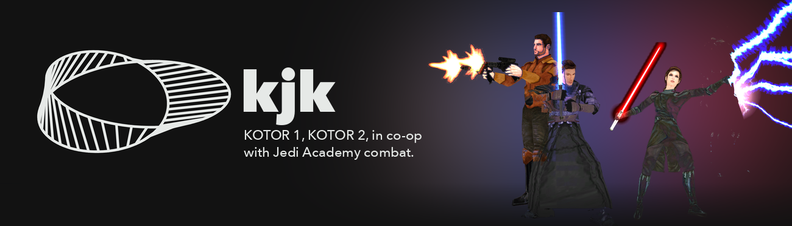

<p align="center"></p>

# kjk

**[Join the Discord](https://discord.gg/23bAu2wvH)**

A Rust engine (Bevy, wgpu) that plays **KOTOR** and **KOTOR II** with
**Jedi Academy**'s real-time movement, sabers and Force, plus native co-op.
KOTOR 1 comes first.

It reads the games from installs you own. **No game data is included here or
in any release.**

## How to play

1. Own and install **KOTOR 1**, **Jedi Academy** and **KOTOR II** (Steam or
   GOG copies are found automatically).
2. Download the file for your computer (macOS, Windows or Linux) from the
   [Releases](https://github.com/kjk-engine/kjk/releases) page and unzip it.
3. Open `kjk`. The first time, it finds your games and sets itself up, then
   shows the main menu.

The builds are not signed, so your computer warns you the first time:

- **macOS:** open System Settings → Privacy & Security and click "Open Anyway".
- **Windows:** click "More info", then "Run anyway".

Movies need [ffmpeg](https://ffmpeg.org/download.html) installed; the game
runs without it.

**Movie Duels (optional).** With Movie Duels installed for Jedi Academy
(its `MD` folder beside `base/`, or its `MD_*.pk3` archives copied into
`base/` itself), kjk finds it by itself
(`KJK_JA_MOD` or `"ja.mod"` in kjk's `settings.json` names another folder).
Options → Gameplay → Sabers then offers Movie Duels' saber rules (Movie
Duels Advanced) and its hilts for KOTOR's lightsabers. Under Movie Duels
Advanced, characters also stand, walk and block in Movie Duels' stances.
Without Movie Duels these choices are greyed and Jedi Academy's rules are
played. Its files come from your own install and are never shipped with
kjk. A co-op player without Movie Duels can join a game played by Jedi
Academy's rules. To join a game played by Movie Duels Advanced, a player
needs the same Movie Duels stance sets as the host
([`docs/VFS.md`](docs/VFS.md)).

### Anti-aliasing and DLSS

Options → Graphics → Advanced → Anti-Aliasing: Off, 2x, 4x and TAA. TAA
blends each frame with the frames before it, which smooths grass and hair
as well as edges.

The downloads do not have NVIDIA's DLSS yet. kjk has the code for DLAA and
for DLSS Quality, Balanced, Performance and Ultra Performance. It will be
in the Windows and Linux downloads once NVIDIA has approved the use of its
marks, which its licence asks for.

- A build from source with the `dlss` feature has DLSS today
  (`docs/BUILD.md`). It needs an NVIDIA RTX card.
- The DLSS choices are shown only when the build, the card and its driver
  offer DLSS. Elsewhere, a saved DLSS choice plays as TAA.
- The code is for NVIDIA's DLSS Super Resolution and DLAA, from the DLSS
  SDK 310.5.3. The neural rendering NVIDIA calls DLSS 5 is for RTX 50
  cards and its SDK is not public, so kjk does not have it.

(Building from source is only needed for development; see
[Development](#development).)

## Playing together

Up to three players: the host plays the main character, friends play the
companions, and the host keeps the save.

- **To host:** choose **Host** on the main menu, then start a new game or load
  a save. Your friends need your IP address, and port 29170 (UDP) must be open
  on your router, unless you are on the same network.
- **To join:** choose **Join** on the main menu, type the host's IP address,
  then your name.

In play: Z takes a break, Y says you are ready to leave an area, and N follows
the next party member while you watch. More in [`docs/COOP.md`](docs/COOP.md).

## Controls

Every key and mouse button rebinds in the options; fighting in detail is in
[`docs/COMBAT.md`](docs/COMBAT.md).

| key | does |
|---|---|
| mouse, W A S D | look, move |
| Space / C / Shift | jump / crouch or roll / walk |
| left / right mouse | attack / weapon's other mode (block, with a lit lightsaber under the duel saber rules) |
| R | weapon's other mode on a key of its own (the lightsaber throw while the right button blocks) |
| E, mouse wheel | use the target, choose the action |
| 1 to 6 | use the six slots of the action bar |
| hold F | open the power wheel |
| ] / [ | right / left hand weapon |
| L | saber style |
| T | next feat attack (guns, two blades, double-bladed, fists, stun baton) |
| H / B / V | draw or holster / weapon set / Form |
| X / U | stealth / Security |
| I J M P K | inventory, journal, map, party, abilities |
| Tab | switch party leader |
| Escape | menu |
| F5 / F9 | quick save / load |
| F1 | first / third person |
| Alt+Enter | borderless / windowed |
| 1–9 | dialogue reply |

### The action bar and the power wheel

The action bar has six slots, and keys 1 to 6 use them. A slot can hold a
Force power, a feat attack, mines, stealth mode, or one kind of item:
medpacs, stims, energy shields or grenades. The HUD shows each slot's icon
and key. A slot that the character cannot use at the moment is drawn grey
and faded. This happens when the character has too few Force points, has no
items of that kind left, or holds a weapon that cannot make that feat
attack. On a controller the bar has four slots. Hold RB and press A, B, X
or Y to use slots 1 to 4.

A new character's bar fills slots 1 to 4 by itself. It puts in the
character's attack powers first, then the feat attacks that fit the weapon
in hand, then grenades, then medpacs. When the character learns a new
attack power, the power goes into the first empty slot of the four. A
stronger version of a power that is already on the bar takes that power's
slot. A new feat attack goes into the first empty slot only when the
character knows no Force powers. The game changes no other slot.

Hold F to open the power wheel. On a controller, hold up on the D-pad. The
wheel lists the character's Force powers, item kinds, mines, feat attacks
and stealth mode, except those on the bar and the powers the player hid.
A weaker version of a power, such as Shock for a character who knows Force
Lightning, is hidden until the player shows it on the setup page. Point at
an entry with the mouse or the right stick. When the player lets go of F,
the character uses that entry. Letting go with no entry pointed at uses
nothing. As on the bar, an entry the character cannot use at the moment is
grey and faded. In a game with one player, the game runs at 25% of its
normal speed while the wheel is open. In a game with more than one player,
it keeps its normal speed.

A character may carry two or more different items of one kind, such as two
different stims. When the wheel points at that kind, an outer arc opens
beside it. The arc lists every item of the kind that the character carries.
The mouse wheel steps through the arc. On a controller, RB steps on and LB
steps back.
On the bar, hold the slot's key and turn the mouse wheel to choose which
item the slot uses. On a controller, hold the slot's buttons and press left
or right on the D-pad.

The **Action bar** button on the Abilities page (K) opens the action bar
setup. The setup also has its own entry in the Keymap, which has no key
until the player binds one. The setup shows the six slots at the top, and
under them every power, feat attack and item kind the character can put on
the bar, as small icons in groups. The box on the right names the icon
under the pointer and gives its description.

- Drag an icon onto a slot to put it there.
- Drag a slot onto another slot to move it there. If the other slot is
  filled, the two slots swap.
- Drag a slot's icon off the bar to empty the slot.
- Right-click a power to hide it from the wheel, and right-click it again
  to show it. A hidden power is drawn grey on this page. On this page, grey
  means only that a power is hidden from the wheel.
- With the pointer over an icon, press a slot's key to put the icon in
  that slot.
- On a controller, press A on an icon and then A on a slot to put it
  there. X on a slot empties it. Y on a power hides it or shows it again.

### Controllers and the Steam Deck

Any pad works alongside the keys (Xbox, PlayStation, Switch Pro, the
Deck's own controls): the left stick moves as far as it is pushed, from
a slow walk to a run; the right stick looks, turning faster while held
over; hold LB for a second layer of actions. When the target offers more
than one action (a mine's Disarm Mine and Recover Mine, a locked door's
Open and Security), hold LB and press left or right on the D-pad to
choose one. The target's panel shows those two buttons beside its
actions. Every screen runs on the D-pad, A, B and X, and the bumpers step
through the menu's tabs. The
prompts name the pad's own buttons while you play with it. Look speed,
invert, dead zone and vibration are under Options → Gameplay →
Controller. A stick that sits off its middle when it is first heard (a
flight throttle or pedals plugged in, which show up as a pad) is ignored
until it comes back to the middle, so it never turns the view or walks
on its own.

Every action rebinds under Options → Gameplay → Keymap, on its
Keyboard and Mouse tabs (any key or mouse button, Mouse 4 and 5
included) or its Controller tab (any button, or an LB or RB chord, shown as
your pad's own buttons). A binding another action has is named first;
press it again and the two swap. Default resets the tab's device.

On the Steam Deck, add kjk to Steam as a non-Steam game (in Desktop
Mode: Games → Add a Non-Steam Game) and start it from **Game Mode**: there
Steam hands it the Deck's controls as a gamepad. Started from Desktop Mode,
Steam turns them into a keyboard and mouse.


## Status

KOTOR 1 plays from the Endar Spire to the credits, light and dark side.
KOTOR II plays from Peragus to the credits as a created Jedi Exile.

- **World:** KOTOR's modules with JA's movement and camera, doors, effects, music, voice and movies.
- **Story:** the games' own scripts run on our NWScript VM: dialogue, journal, XP, party, items, stores.
- **Combat:** KOTOR's character sheets under JA's sabers, blasters and Force.
- **Screens:** KOTOR's menus and HUD in TSL's style.
- **Minigames:** pazaak, swoop racing, the Ebon Hawk's turret.
- **Saves:** from the menus, F5 / F9 quick save and load.

**Before reporting a bug, read [`KNOWN-ISSUES.md`](KNOWN-ISSUES.md).**

## Development

Building from source needs Rust (the pinned version installs itself) and is
covered in [`docs/BUILD.md`](docs/BUILD.md). Games outside Steam and GOG go in
`.env` (copy `.env.example`).

```bash
cargo run --release -p launcher            # build and open the main menu
kjk play --stage end_m01aa                 # one module (--class jedi for the Force)
kjk host --stage end_m01aa                 # host co-op from the command line
kjk join 192.0.2.20                        # join by IP, or by Steam name (source builds only)
kjk chain k1                               # the whole campaign, headless
```

| path | what |
|---|---|
| `crates/` | the engine, one crate per part (`sim`, `collision`, `script_ncs`, `net`, `ui`, `game`, `launcher`, …) |
| `data/` | our own data: rules, clip brushes, routes |
| `docs/` | how each part works ([`docs/INDEX.md`](docs/INDEX.md)) |
| `ROADMAP.md` | goals, decisions, what's next |
| `QUIRKS.md` | original behaviour kept on purpose |
| `KNOWN-ISSUES.md` | known bugs and unfinished parts |

Contributing: [`CONTRIBUTING.md`](CONTRIBUTING.md).

## License

MIT ([`LICENSE`](LICENSE)). No game data, ever; behaviour references are
credited in [`NOTICE`](NOTICE).

Star Wars, Knights of the Old Republic and Jedi Academy are trademarks of
their owners; kjk is not affiliated with or endorsed by them.
