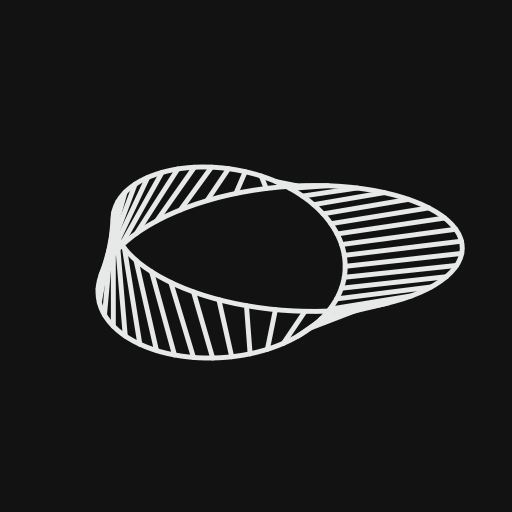

<p align="center"></p>

# kjk

A Rust engine (Bevy, wgpu) that plays **KOTOR** and **KOTOR II** with
**Jedi Academy**'s real-time movement, sabers and Force, plus native co-op.
KOTOR 1 comes first.

It reads the games from installs you own. **No game data is included here or
in any release.**

## How to play

1. Own and install **KOTOR 1**, **Jedi Academy** and **KOTOR II** (Steam or
   GOG copies are found automatically).
2. Download the file for your computer (macOS, Windows or Linux) from the
   [Releases](https://github.com/kjk-engine/kjk/releases) page and unzip it.
3. Open `kjk`. The first time, it finds your games and sets itself up, then
   shows the main menu.

The builds are not signed, so your computer warns you the first time:

- **macOS:** open System Settings → Privacy & Security and click "Open Anyway".
- **Windows:** click "More info", then "Run anyway".

Movies need [ffmpeg](https://ffmpeg.org/download.html) installed; the game
runs without it.

(Building from source is only needed for development; see
[Development](#development).)

## Playing together

Up to three players: the host plays the main character, friends play the
companions, and the host keeps the save.

- **To host:** choose **Host** on the main menu, then start a new game or load
  a save. Your friends need your IP address, and port 29170 (UDP) must be open
  on your router, unless you are on the same network.
- **To join:** choose **Join** on the main menu, type the host's IP address,
  then your name.

In play: Z takes a break, Y says you are ready to leave an area, and N follows
the next party member while you watch. More in [`docs/COOP.md`](docs/COOP.md).

## Controls

Every key rebinds in the options; fighting in detail is in
[`docs/COMBAT.md`](docs/COMBAT.md).

| key | does |
|---|---|
| mouse, W A S D | look, move |
| Space / C / Shift | jump / crouch or roll / walk |
| left / right button | attack / weapon's other mode |
| E, mouse wheel | use the target, choose the action |
| 1 / 2 | right / left hand weapon |
| L | saber style |
| F, [ ] | cast / select a power |
| G / R / Q | grip / lightning / drain |
| T | grenade (hold to charge) |
| 3 / 4 / 5 | medpac / stim / energy shield |
| H / B / V | holster / weapon set / Form |
| X / O / U | stealth / mine / Security |
| I J M P K | inventory, journal, map, party, abilities |
| Tab | switch party leader |
| Escape | menu |
| F5 / F9 | quick save / load |
| F1 | first / third person |
| Alt+Enter | borderless / windowed |
| 1–9 | dialogue reply |

## Status

KOTOR 1 plays from the Endar Spire to the credits, light and dark side.

- **World:** KOTOR's modules with JA's movement and camera, doors, effects, music, voice and movies.
- **Story:** the games' own scripts run on our NWScript VM: dialogue, journal, XP, party, items, stores.
- **Combat:** KOTOR's character sheets under JA's sabers, blasters and Force.
- **Screens:** KOTOR's menus and HUD in TSL's style.
- **Minigames:** pazaak, swoop racing, the Ebon Hawk's turret.
- **Saves:** from the menus, F5 / F9 quick save and load.

Not yet: TSL's campaign past Peragus. **Before reporting a bug, read
[`KNOWN-ISSUES.md`](KNOWN-ISSUES.md).**

## Development

Building from source needs Rust (the pinned version installs itself) and is
covered in [`docs/BUILD.md`](docs/BUILD.md). Games outside Steam and GOG go in
`.env` (copy `.env.example`).

```bash
cargo run --release -p launcher            # build and open the main menu
kjk play --stage end_m01aa                 # one module (--class jedi for the Force)
kjk host --stage end_m01aa                 # host co-op from the command line
kjk join 192.0.2.20                        # join by IP, or by Steam name (source builds only)
kjk chain k1                               # the whole campaign, headless
```

| path | what |
|---|---|
| `crates/` | the engine, one crate per part (`sim`, `collision`, `script_ncs`, `net`, `ui`, `game`, `launcher`, …) |
| `data/` | our own data: rules, clip brushes, routes |
| `docs/` | how each part works ([`docs/INDEX.md`](docs/INDEX.md)) |
| `ROADMAP.md` | goals, decisions, what's next |
| `QUIRKS.md` | original behaviour kept on purpose |
| `KNOWN-ISSUES.md` | known bugs and unfinished parts |

Contributing: [`CONTRIBUTING.md`](CONTRIBUTING.md).

## License

MIT ([`LICENSE`](LICENSE)). No game data, ever; behaviour references are
credited in [`NOTICE`](NOTICE).

Star Wars, Knights of the Old Republic and Jedi Academy are trademarks of
their owners; kjk is not affiliated with or endorsed by them.
